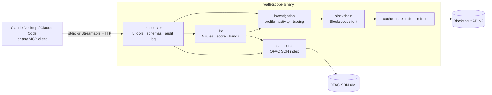

# WalletScope MCP

**Explainable Ethereum wallet investigation for AI assistants.** WalletScope is a
single Go binary that exposes five [Model Context Protocol](https://modelcontextprotocol.io)
tools. With them, Claude (or any MCP client) can profile a wallet, list its
activity, trace where funds went, screen it against the official OFAC SDN list,
and produce a 0–100 risk score in which every point is backed by a named rule
and transaction hashes.

> "Investigate this Ethereum wallet. Show me where its funds went, check for
> sanctions exposure, and explain its risk score with transaction evidence."

Claude answers by calling WalletScope tools and citing the returned evidence.
See a [real captured Claude Code session](docs/demo/claude-code-session-2026-10-29.md).

---

## Contents

1. [Problem](#problem) · 2. [Features](#features) · 3. [Architecture](#architecture) ·
4. [Tools](#tools) · 5. [Risk scoring](#risk-scoring) · 6. [Data sources](#data-sources-and-provenance) ·
7. [Install & build](#install-and-build) · 8. [Claude Desktop](#claude-desktop) · 9. [Claude Code](#claude-code) ·
10. [Streamable HTTP](#streamable-http) · 11. [Docker](#docker) · 12. [Testing](#testing-and-verification) ·
13. [Example investigation](#example-investigation) · 14. [Configuration](#configuration) ·
15. [Limitations](#known-limitations-and-future-work) · 16. [Security & responsible use](#security-and-responsible-use)

---

## Problem

Answering "is this wallet risky?" usually means juggling a block explorer, a
sanctions list and a spreadsheet. An LLM can do the synthesis, but only if it gets
**structured, sourced, honest** data. In particular:

* exact amounts, never floats;
* failed transactions clearly separated from real transfers;
* missing data reported as missing, never as "clean".

WalletScope provides that layer.

## Features

* **Five MCP tools**: `get_address_info`, `get_transactions`, `trace_funds`, `check_sanctions`, `risk_report`.
* **Real data**: the [Blockscout](https://eth.blockscout.com) REST API v2 (no API key) and the official
  [OFAC SDN XML](https://sanctionslistservice.ofac.treas.gov/api/PublicationPreview/exports/SDN.XML).
* **Explainable risk engine**: five deterministic rules with documented weights, overlap handling, a score cap
  and completeness-aware bands ([risk model](docs/risk-model.md)).
* **Bounded 1–3 hop fund tracing**: worker pool, a shared rate limiter, and node/edge/API-call/time budgets.
  Cycles are handled, output is deterministic, and partial results come with warnings.
* **Evidence everywhere**: tx hashes, counterparties, SDN entry uid/programs, dataset publish date, retrieval
  timestamps, coverage per source.
* **Address-poisoning aware**: outgoing token events in transactions the wallet never signed are flagged
  `initiated_by_wallet=false` and are not scored as the wallet's own actions.
* **Resilience**: TTL+LRU cache that stores successes only, token-bucket rate limiting, and bounded retries with
  jitter and `Retry-After`. Requests are cancellation-aware.
* **Two transports**: stdio for Claude Desktop/Code, and Streamable HTTP with bearer auth, cross-origin
  protection, body limits, health/readiness endpoints and graceful shutdown.
* **Structured audit logs** (`log/slog`, stderr only), correlated by `request_id` and caller-supplied `investigation_id`.
* **Operations**: 12 MB distroless non-root Docker image and an offline test suite including the race detector.

## Architecture



Details, sequence diagrams and package responsibilities: [docs/architecture.md](docs/architecture.md).
Design decisions and phase plan: [IMPLEMENTATION_PLAN.md](IMPLEMENTATION_PLAN.md).

## Tools

All tools take an optional `investigation_id`, which is echoed into audit logs so the calls behind one report can
be correlated. Addresses are validated: mixed-case input must be a correct EIP-55 checksum. Outputs are
returned both as `structuredContent` (with an output schema) and as JSON text.

| Tool | Input | Returns |
|---|---|---|
| `get_address_info` | `address`, `chain` (default `ethereum`, the only supported chain) | Balance (exact wei and formatted ETH), account type (`eoa`, `eoa_eip7702_delegated`, `contract`), provider counters, ENS, provider labels, last observed activity. `first_observed` is returned **only** when the full indexed history was read. Also returns coverage and limitations. |
| `get_transactions` | `address`, `limit` 1–100 (default 20), `direction` `in`/`out`/`both` (default `both`) | Newest-first activity merged from transactions, internal transfers and ERC-20 events. Each item has `kind`, `direction`, `status`, `transfer_confirmed`, the exact amount and the asset; outgoing token events also carry `initiated_by_wallet`. Also returns confirmed in/out ETH totals and `has_more`. |
| `trace_funds` | `address`, `hops` 1–3 (default 2), `min_amount` (decimal string in whole units of the asset, default `"0.1"`), `asset` (`native` or an ERC-20 contract) | Directed graph. Nodes carry hop, labels, flags (`ofac_sdn:…`, `mixer:…`) and `stop_reason`. Edges carry the exact aggregated total, transfer count, tx hashes and first/last seen. Also returns `flagged_nodes` with discovery paths, stats, the limits applied, `partial` and warnings. |
| `check_sanctions` | `address` | `match` (SDN name, uid, programs, aliases, identifier type, listed asset and value), `no_match`, or `inconclusive` (dataset unavailable). Includes dataset publish date, source URL, last successful load and staleness, plus a disclaimer. |
| `risk_report` | `address` | Score, `score_is_lower_bound`, band and label, `assessment_status`, findings (rule, points, severity, explanation, tx hashes, counterparties, sources, confidence, limitations), triggered/not-triggered/not-evaluated status for every rule, union of evidence hashes, data sources, coverage, reviewed window, warnings and summary. |

Example (real output, trimmed, from [docs/demo/live-run-2026-10-29](docs/demo/live-run-2026-10-29)):

```json
// risk_report {"address":"0x212B8e1f935B779bBa6DD6Ca7c29c30aAa6e37BB"}
{
  "score": 30, "score_is_lower_bound": false,
  "risk_band": "moderate", "risk_band_label": "Elevated indicators requiring review",
  "assessment_status": "complete", "model_version": "walletscope-risk-v1",
  "findings": [{
    "rule_id": "MIXER_INTERACTION", "severity": "medium", "points": 30,
    "evidence_tx_hashes": ["0xbfe54a96d126145167709dc0c6a4e566ebe2b9b2e0adfb77083d6b188bc5f3b4"],
    "counterparties": [{"address": "0x910Cbd523D972eb0a6f4cAe4618aD62622b39DbF",
                        "role": "Tornado Cash 10 ETH pool", "direction": "received_from", "tx_count": 1}],
    "confidence": "high: confirmed transfers from a verified mixer contract address"
  }],
  "rule_evaluations": [
    {"rule_id": "SANCTIONS_DIRECT", "status": "not_triggered"},
    {"rule_id": "SANCTIONS_ONE_HOP", "status": "not_triggered"},
    {"rule_id": "MIXER_INTERACTION", "status": "triggered"},
    {"rule_id": "DEPOSITS_THEN_LARGE_OUTFLOW", "status": "not_triggered"},
    {"rule_id": "NEW_WALLET_LARGE_TRANSFER", "status": "not_triggered",
     "reason": "wallet is new but no native transfer reached the large-transfer threshold"}
  ]
}
```

```json
// trace_funds edge (hop 2), same investigation
{"from": "0x55ca12EFBe95ce1903874a66B6eAeAD1377E9473", "to": "0x2CfF890f0378a11913B6129B2E97417a2c302680",
 "hop": 2, "total": {"raw": "9962285000000000000", "decimals": 18, "formatted": "9.962285", "symbol": "ETH"},
 "transfer_count": 1, "tx_hashes": ["0xe6af4b22eb53c12a274020690561bf32bca561de6d5e4821a5e46314d40131c7"]}
```

## Risk scoring

The full specification is in [docs/risk-model.md](docs/risk-model.md).

| Rule | Points | Triggered when | Key limitation |
|---|---|---|---|
| `SANCTIONS_DIRECT` | 100 (forces score 100) | Address equals an EVM-format digital-currency identifier in the loaded SDN file | Only identifiers OFAC has published |
| `SANCTIONS_ONE_HOP` | 60 sent-to · 40 received-from / unsigned token event | A confirmed counterparty in the reviewed window is SDN-listed | Incoming transfers can be unsolicited (dusting) |
| `MIXER_INTERACTION` | 40 deposit/call · 30 withdrawal | Counterparty is a configured mixer (default: 6 Tornado Cash contracts verified by Blockscout contract name) | Mixers have legitimate privacy uses |
| `DEPOSITS_THEN_LARGE_OUTFLOW` | 25 | ≥5 incoming deposits, each ≤ ⅓ of a later outflow, within 72 h, summing to ≥ 50 % of it (same asset) | Payroll and exchange sweeps look similar |
| `NEW_WALLET_LARGE_TRANSFER` | 20 | Full history read, first activity < 30 days old, a native transfer ≥ 10 ETH | ETH only (no price oracle) |

* **Aggregation**: `min(100, Σ points)`, with each rule counted at most once. A counterparty that is both
  sanctioned and a mixer counts only once (the mixer finding is shown with 0 points and a `suppressed_reason`).
* **Bands**: severe ≥ 75 · high ≥ 50 · moderate ≥ 25 · low ≥ 1. A score of 0 is reported as `none_detected`
  only after a *complete* assessment. Otherwise it is `none_detected_in_reviewed_window` or `indeterminate`.
* **Missing data never lowers risk**: if the sanctions dataset or the history is unavailable,
  `assessment_status` is `insufficient_data`/`partial` and `score_is_lower_bound` is true.
* Scores are **indicators requiring review**, not probabilities or legal findings.

## Data sources and provenance

| Source | Used for | Notes |
|---|---|---|
| Blockscout API v2 (`WALLETSCOPE_BLOCKSCOUT_URL`, default `https://eth.blockscout.com/api/v2`) | Address profile, counters, transactions, internal transactions, ERC-20 transfers | Public, keyless. Rate limited (`x-ratelimit-*` headers). Index completeness depends on the instance. Lists newest first and has no first-seen field. |
| OFAC SDN XML (`WALLETSCOPE_OFAC_SOURCE`) | Sanctions screening | Downloaded at startup (about 29 MB, about 15 s), streamed and parsed, refreshed every 24 h. A failed refresh keeps the previous dataset. Can be pointed at a local file. 2026-10-28 publication: 19,484 entries, 137 EVM-format identifiers. |
| Mixer list (`WALLETSCOPE_MIXER_ADDRESSES`) | Mixer rule, trace flags | Tornado Cash is **not** in the current SDN file (delisted March 2025), so it is a separate, documented list. |

Every tool result includes `source`, `source_url` and `retrieved_at` (UTC). Sanctions results include the
dataset `publish_date` and `last_successful_load`.

## Install and build

Requirements: Go 1.26+ (developed and verified with **Go 1.27.3**). Docker is optional.

```bash
git clone https://github.com/amnariaz007/walletscope-mcp.git
cd walletscope-mcp
go mod tidy
go fmt ./... && go vet ./...
go test ./...            # offline; no API keys or network needed
go test -race ./...
go build -o bin/walletscope ./cmd/walletscope    # or: make build
./bin/walletscope -version
```

`make build` produces a static, trimmed binary plus `bin/mcpcall`, a small SDK-based MCP client used by the
scripts.

## Web interface (no terminal needed)

```bash
./bin/walletscope ui            # or: make ui — opens http://127.0.0.1:8090/ in your browser
```

* Paste an address and press **Investigate**. The page runs all five tools in turn and shows:
  * the risk score with each finding and its evidence;
  * the sanctions result;
  * the fund trace, hop by hop;
  * the profile and recent activity.
* Transactions and addresses link to the Blockscout explorer, and every card has a *Raw JSON* toggle.
* The page calls the tools through an in-process MCP session, so it gets the same validation and output as
  Claude does.
* It binds to loopback only, rejects non-local `Host` headers (DNS-rebinding guard), uses no external scripts,
  and has a **Stop server** button.
* On macOS, `scripts/launch-ui.sh` builds the binary if needed, starts the UI in the background (logging to
  `~/Library/Logs/WalletScope.log`) and opens the browser. Wrap it as a double-clickable app with:
  `osacompile -o WalletScope.app -e 'do shell script quoted form of "/ABSOLUTE/PATH/scripts/launch-ui.sh"'`.

## Claude Desktop

Edit `~/Library/Application Support/Claude/claude_desktop_config.json` (macOS) or
`%APPDATA%\Claude\claude_desktop_config.json` (Windows), use an **absolute** path, and restart Claude Desktop:

```json
{
  "mcpServers": {
    "walletscope": {
      "command": "/ABSOLUTE/PATH/TO/walletscope-mcp/bin/walletscope",
      "args": [],
      "env": { "WALLETSCOPE_LOG_LEVEL": "info" }
    }
  }
}
```

A Docker-based variant is in [examples/claude_desktop_config.docker.json](examples/claude_desktop_config.docker.json).
*This configuration follows the documented format but has not been tested in the Claude Desktop app itself;
the app was not installed on the development machine.*

## Claude Code

```bash
# stdio (local binary)
claude mcp add walletscope -- /ABSOLUTE/PATH/TO/walletscope-mcp/bin/walletscope

# or Streamable HTTP
claude mcp add --transport http walletscope http://127.0.0.1:8080/mcp \
  --header "Authorization: Bearer $WALLETSCOPE_HTTP_AUTH_TOKEN"
```

A project-scoped `.mcp.json` example is in [examples/mcp.json](examples/mcp.json).
**Verified:** Claude Code 2.1.312 connected over stdio with
`claude -p … --mcp-config mcp.json --strict-mcp-config` and called all five tools. See the
[captured session](docs/demo/claude-code-session-2026-10-29.md).

## Streamable HTTP

```bash
export WALLETSCOPE_HTTP_AUTH_TOKEN=$(openssl rand -hex 24)
WALLETSCOPE_TRANSPORT=http ./bin/walletscope        # listens on 127.0.0.1:8080
curl -s localhost:8080/healthz                      # {"status":"ok"}
curl -s localhost:8080/readyz                       # 200 once the OFAC dataset is loaded, else 503 "degraded"
./bin/mcpcall -url http://127.0.0.1:8080/mcp -token "$WALLETSCOPE_HTTP_AUTH_TOKEN" \
  -tool check_sanctions -args '{"address":"0x098B716B8Aaf21512996dC57EB0615e2383E2f96"}'
```

Security model:

* **Authentication**: a static bearer token (`WALLETSCOPE_HTTP_AUTH_TOKEN`, at least 16 characters) is compared
  in constant time. Requests without it get `401`. There are no per-analyst accounts.
* **Safe defaults**: the server binds to `127.0.0.1`. If you bind to a non-loopback address without a token,
  the server **refuses to start** unless you set `WALLETSCOPE_HTTP_ALLOW_UNAUTHENTICATED=true`, which is meant
  only for an isolated, trusted network.
* **Request protections**: the SDK's localhost DNS-rebinding protection, Go's `http.CrossOriginProtection`, a
  1 MiB request body limit (413 above it), header/read/idle timeouts, and per-tool deadlines. Responses send
  `nosniff`/`no-store` headers. Internal errors and upstream URLs are not exposed.
* **TLS**: WalletScope does not terminate TLS. For anything beyond localhost, put it behind a TLS reverse proxy
  and treat the token as a secret.
* **Sessions** idle for 30 minutes are closed. `SIGINT`/`SIGTERM` trigger a graceful shutdown (15 s drain).

## Docker

```bash
docker build -t walletscope-mcp:local .            # multi-stage → distroless static, non-root (≈12 MB)

# HTTP (default in the image; binds 0.0.0.0 inside, so a token is mandatory)
docker run --rm -p 127.0.0.1:8080:8080 -e WALLETSCOPE_HTTP_AUTH_TOKEN="$TOKEN" \
  --read-only --cap-drop ALL walletscope-mcp:local
# or: WALLETSCOPE_HTTP_AUTH_TOKEN=... docker compose up

# stdio (for MCP clients that launch a command); logs go to stderr, stdout is protocol-only
docker run -i --rm walletscope-mcp:local -transport stdio
```

The image has a `HEALTHCHECK` (`/walletscope healthcheck`, since there is no shell or curl in distroless).
**Verified:** `make docker-smoke` builds the image and checks:

* the container refuses to start without a token;
* `/healthz` and the in-container healthcheck pass;
* it runs as `nonroot`;
* `check_sanctions` works over HTTP;
* `get_transactions` works over `docker run -i` stdio.

## Testing and verification

```bash
go test ./...                 # offline suite (httptest + fixtures, no network)
go test -race ./...           # race detector
go test -short ./...          # skips the test that compiles and drives the real binary
make smoke                    # LIVE: real Blockscout + OFAC over stdio and HTTP
make docker-smoke             # LIVE: container over HTTP and stdio
WALLETSCOPE_SDN_FILE=/path/to/SDN.XML go test -run TestParseFullOfficialFile -v ./internal/sanctions/
```

| Area | What is tested |
|---|---|
| `blockchain` | Recorded Blockscout fixtures; pagination cursor replay; failed/pending/contract-creation txs; token decimals; 429 + `Retry-After`; bounded 5xx retries; no retry on 4xx; malformed JSON is not cached; timeouts; cancellation during backoff; secret redaction; EIP-55 |
| `investigation` | Direction/limit defaults; pagination and dedup; partial vs total source failure; first-seen only with full history; tracing depth, min amount, self-transfers, cycles, contract leaves, flags and paths, node/child/API budgets, provider failure isolation, worker bound, cancellation, determinism, token/ETH separation |
| `sanctions` | Real SDN excerpt parsing; direct match with record details; EVM ids listed under USDT; `no_match` only with a loaded dataset; `inconclusive` on failure; failed refresh keeps the old dataset; fast initial retry; staleness |
| `risk` | All 7 required regressions (direct, one-hop vs direct, mixer only for configured addresses, deposit pattern conditions, new wallet, missing data ≠ low risk, evidence on every finding), plus overlap, cap, bands, asset separation, address poisoning, determinism under input shuffling |
| `app` (integration) | All five tools over in-memory MCP; schema-level input errors as tool errors; sanctions-unavailable path; stdio framing; **the compiled binary over stdio**; Streamable HTTP with auth, health and readiness; 413 on oversized bodies; graceful shutdown |
| `cache`, `ratelimit`, `config` | Expiry, LRU bound, concurrency; burst/rate, shared waiters, cancellation refund; defaults, aggregated validation errors, public-bind guard |

Fixture provenance: [testdata/README.md](testdata/README.md).

## Example investigation

```bash
make build
./scripts/demo.sh                                   # live: 5 tools in one MCP session (default address below)
./scripts/demo.sh 0xYourAddress
./scripts/demo.sh --offline                         # no network: synthetic scenario + OFAC fixture (labelled)
```

A real run against `0x212B8e1f935B779bBa6DD6Ca7c29c30aAa6e37BB` (2026-10-29) is in
[docs/demo/live-run-2026-10-29](docs/demo/live-run-2026-10-29). Here is what the five calls showed:

1. **`get_address_info`**: a fresh EOA, first active 2026-10-29 10:47 UTC, almost empty.
2. **`get_transactions`**: a 9.962318 ETH internal transfer *from* the Tornado Cash 10 ETH pool, then two
   outgoing ETH sends. Six fake-"ETH" token events are marked `initiated_by_wallet: false` (address poisoning).
3. **`check_sanctions`**: `no_match` against the SDN list published 10/28/2026.
4. **`trace_funds`** (2 hops, ≥ 0.1 ETH):
   * 9.962314 ETH went to a contract labelled `Deposit` (a leaf, not expanded).
   * 9.962285 ETH went to `0x55ca…9473`, which forwarded it within a minute to `0x2CfF…2680`, labelled
     "NEAR Intents" by the provider.
5. **`risk_report`**: **30/100, moderate, complete assessment**. The only finding is `MIXER_INTERACTION`
   (withdrawal), with the evidence tx hash.

### Demo GIF

No GIF is included yet. None was recorded, because screen capture of a desktop client was not available in the
build environment. To capture one:

1. Configure Claude Desktop (above) and restart it. Confirm the 🔌 tools menu lists the 5 WalletScope tools.
2. Start a screen recorder (macOS: `⌘⇧5` → *Record Selected Portion*).
3. Ask: *"Investigate this Ethereum wallet: 0x212B8e1f935B779bBa6DD6Ca7c29c30aAa6e37BB. Show me where its funds
   went, check for sanctions exposure, and explain its risk score with transaction evidence."*
4. Approve the tool calls and let the answer finish. Keep the recording under about 60 s.
5. Convert it: `ffmpeg -i rec.mov -vf "fps=10,scale=960:-1" -loop 0 docs/media/walletscope-demo.gif`.
6. Embed it here with ``.

## Configuration

All settings are environment variables with validated defaults. Invalid values abort startup, and **all**
errors are listed at once.

| Variable | Default | Meaning |
|---|---|---|
| `WALLETSCOPE_TRANSPORT` | `stdio` | `stdio` or `http` (flag `-transport` overrides) |
| `WALLETSCOPE_HTTP_ADDR` | `127.0.0.1:8080` | HTTP bind address |
| `WALLETSCOPE_HTTP_AUTH_TOKEN` | — | Bearer token (≥ 16 chars); required for non-loopback binds |
| `WALLETSCOPE_HTTP_ALLOW_UNAUTHENTICATED` | `false` | Allow a non-loopback bind without a token (trusted networks only) |
| `WALLETSCOPE_BLOCKSCOUT_URL` | `https://eth.blockscout.com/api/v2` | Provider base URL |
| `WALLETSCOPE_UPSTREAM_TIMEOUT` | `20s` | Per-request timeout |
| `WALLETSCOPE_UPSTREAM_RPS` / `_BURST` | `5` / `10` | Shared upstream rate limit |
| `WALLETSCOPE_UPSTREAM_RETRIES` | `3` | Max retries for transient failures |
| `WALLETSCOPE_CACHE_TTL` / `_MAX_ENTRIES` | `2m` / `2000` | Response cache |
| `WALLETSCOPE_TOOL_TIMEOUT` | `45s` | Deadline for profile/activity/sanctions tools |
| `WALLETSCOPE_TRACE_WORKERS` | `4` | Concurrent lookups per hop |
| `WALLETSCOPE_TRACE_MAX_HOPS` | `3` | Upper bound for `hops` (1–3) |
| `WALLETSCOPE_TRACE_MAX_NODES` / `_EDGES` / `_API_CALLS` | `200` / `500` / `120` | Trace budgets |
| `WALLETSCOPE_TRACE_MAX_CHILDREN` | `10` | Largest recipients kept per address |
| `WALLETSCOPE_TRACE_TIMEOUT` | `60s` | Trace wall-clock budget |
| `WALLETSCOPE_TRACE_EXPAND_CONTRACTS` | `false` | Expand contract nodes |
| `WALLETSCOPE_OFAC_SOURCE` | official SDN.XML URL | URL or local file path |
| `WALLETSCOPE_OFAC_REFRESH` / `_LOAD_TIMEOUT` / `_WAIT_ON_QUERY` | `24h` / `3m` / `45s` | Dataset refresh cadence, download timeout, max wait for initial load |
| `WALLETSCOPE_MIXER_ADDRESSES` | 6 Tornado Cash contracts | `0xaddr=Label,…` or `none` |
| `WALLETSCOPE_RISK_HISTORY_PAGES` | `4` | Pages (×50) per source read for risk/profile |
| `WALLETSCOPE_RISK_TIMEOUT` | `90s` | `risk_report` deadline |
| `WALLETSCOPE_STRUCTURING_MIN_DEPOSITS` / `_WINDOW` / `_MULTIPLE` / `_COVERAGE_PCT` | `5` / `72h` / `3` / `50` | Deposit-pattern rule |
| `WALLETSCOPE_NEW_WALLET_AGE` / `WALLETSCOPE_LARGE_TRANSFER_ETH` | `720h` / `10` | New-wallet rule |
| `WALLETSCOPE_LOG_LEVEL` / `_FORMAT` | `info` / `json` | Logging (always to stderr) |

## Known limitations and future work

* **Coverage**: Ethereum mainnet only. Busy wallets are assessed over their most recent activity (see
  `reviewed_window`), and Blockscout's public index may lag.
* **Tracing**: reads one page (50 items) of outgoing activity per source per address, so heavy senders are
  flagged `history_truncated`. ERC-20 traces filter locally and do not apply `initiated_by_wallet`. Cross-chain
  bridges end the trace.
* **Sanctions**: SDN direct identifiers only. The consolidated (non-SDN) lists are not loaded, and the dataset is
  re-downloaded on every process start because there is no persistence by design.
* **Risk**: exposure is scored one hop away; multi-hop exposure is visible in `trace_funds` but not scored.
  Weights are engineering judgements, not calibrated.
* **Future work**: on-disk OFAC cache, additional providers behind `blockchain.Provider`, multi-chain EVM
  support, scored multi-hop exposure, an exchange/bridge label source, and OAuth for HTTP.

## Security and responsible use

* WalletScope **reads public data only**. It holds no keys and performs no on-chain actions.
* Results are investigative leads. A sanctions **screening hit is not a legal determination**, `no_match` is
  **not compliance clearance**, and risk scores are **indicators requiring review**. Do not use WalletScope as
  the sole basis for freezing funds, denying service or accusing anyone.
* Do not infer identity from labels. Provider labels and ENS names do not prove ownership.
* Audit logs record the queried address, tool and timing (not full payloads, never secrets). Treat them as
  sensitive investigative records.
* Report vulnerabilities privately to the repository owner rather than in public issues.

## License

No license has been chosen yet. Add one (for example MIT or Apache-2.0) before publishing.
