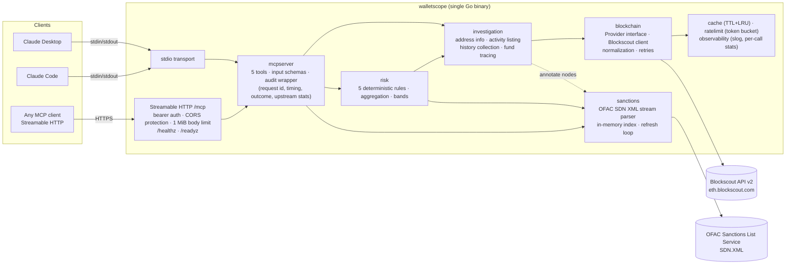
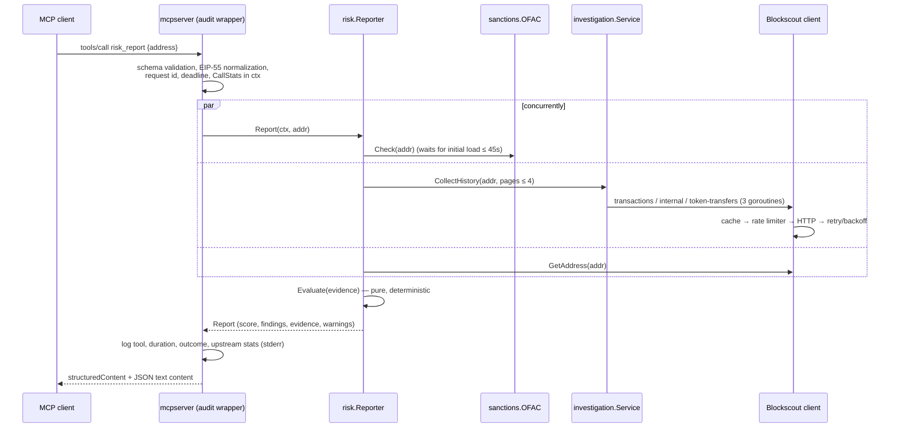

# WalletScope architecture

## Component view



## Packages

| Package | Responsibility | Key types |
|---|---|---|
| `cmd/walletscope` | Flags, config load, signal handling, transport selection, `healthcheck` subcommand | — |
| `internal/app` | Wires config → services → transports; HTTP security middleware; shared by tests | `App` |
| `internal/config` | Env parsing, defaults, semantic validation (fails fast, reports all errors) | `Config`, `ParseDecimalUnits` |
| `internal/mcpserver` | Tool definitions and schemas (official SDK `mcp.AddTool`), audit wrapper | `Deps`, tool inputs |
| `internal/investigation` | Address profile, activity listing, bounded history collection, BFS fund tracing | `Service`, `History`, `TraceResult` |
| `internal/risk` | Pure rule evaluation over collected `Evidence`; `Reporter` gathers evidence | `Evaluate`, `Reporter`, `Report` |
| `internal/sanctions` | OFAC SDN loader/indexer, refresh, match/no_match/inconclusive | `Screener`, `OFAC` |
| `internal/blockchain` | Data contracts, EIP-55 addresses, exact amounts, Blockscout client | `Provider`, `Activity`, `Amount` |
| `internal/cache` | Generic bounded TTL + LRU cache | `Cache[V]` |
| `internal/ratelimit` | Context-aware token bucket shared by all workers | `Limiter` |
| `internal/observability` | slog setup (stderr), per-call atomic counters, IDs | `CallStats` |

Dependency direction is strictly downward (`mcpserver → risk → investigation/sanctions → blockchain → cache/ratelimit/observability`); there are no import cycles and no package reaches "up".

## Request lifecycle (`risk_report`)



## Fund tracing (`trace_funds`)

* Breadth-first by hop. Each hop's frontier is processed by a pool of
  `WALLETSCOPE_TRACE_WORKERS` goroutines fed from an unbuffered channel; every
  worker exits when the channel closes, and the feeder stops on context
  cancellation, so no goroutine outlives the call.
* Workers write results into a slice indexed by frontier position; merging
  happens after `wg.Wait()` in sorted address order, so the graph is identical
  regardless of scheduling (tested).
* Global budgets: nodes, edges, upstream calls (atomic counter checked before
  every request), wall time (`context.WithTimeout`). Hitting any budget marks
  the result `partial` with a warning and a per-node `stop_reason`.
* Cycles: a visited map ensures each address is expanded at most once; edges
  into visited nodes are kept and marked `to_visited_earlier`.
* Contracts and flagged (sanctioned / mixer) nodes are leaves by default.
* All upstream requests share one rate limiter, so concurrency never exceeds the
  configured requests per second.

## Upstream resilience (Blockscout client)

| Concern | Behaviour |
|---|---|
| Timeouts | per-request `context.WithTimeout` (`WALLETSCOPE_UPSTREAM_TIMEOUT`) inside the caller's deadline |
| Retries | 429, 500, 502, 503, 504 and transport errors; exponential backoff with jitter, capped; `Retry-After` honoured; never retries 4xx like 400/404/422; never sleeps past the caller's deadline |
| Rate limit | shared token bucket (`WALLETSCOPE_UPSTREAM_RPS`, `…_BURST`) |
| Caching | successful, well-formed responses only, keyed by full URL incl. query (`WALLETSCOPE_CACHE_TTL`, `…_MAX_ENTRIES`); errors and malformed bodies are never cached |
| Validation | strict decoding; missing hashes/senders, negative or non-integer amounts and bad timestamps → `ErrBadResponse` |
| Secrets | URL query strings are stripped from transport errors before logging |

## Data contracts

* **Addresses**: EIP-55 checksummed everywhere; mixed-case input must carry a
  valid checksum (catches typos); provider/OFAC values are normalized
  case-insensitively.
* **Amounts**: `{raw, decimals, formatted, symbol}` — `raw` is the integer in
  base units, `formatted` is exact (no floats). Unknown decimals leave
  `formatted` empty rather than guessing.
* **Activity kinds**: `native_transfer`, `contract_call` (value 0, an
  interaction not a transfer), `internal_transfer`, `token_transfer`.
  `transfer_confirmed` is true only when value actually moved.
* **Provenance**: every response carries `chain`, `source`, `source_url`,
  `retrieved_at` (UTC) and completeness flags (`complete`, `partial`,
  `coverage`, `assessment_status`).

## Logging

Structured JSON (`log/slog`) on **stderr** only — in stdio mode stdout carries
nothing but MCP messages (verified by the binary-level stdio test and the
Docker stdio smoke test). One `tool call` line per invocation:

```json
{"level":"INFO","msg":"tool call","tool":"risk_report","request_id":"req_…","investigation_id":"demo-…",
 "address":"0x212B…","duration_ms":2,"outcome":"success","upstream_requests":0,"upstream_errors":0,
 "upstream_retries":0,"cache_hits":4,"cache_misses":0}
```

Operational logs are not evidence; evidence is the transaction hashes and
dataset records in tool results.
